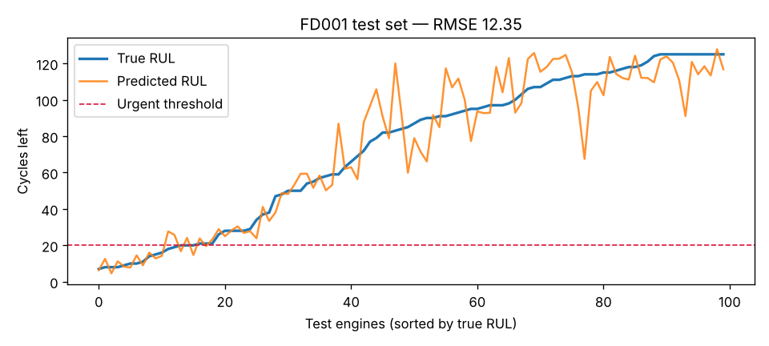

# RUL Predictor — maintenance prédictive de turboréacteurs

**Estimer le nombre de cycles restants avant panne d'un moteur (Remaining Useful Life) et transformer cette estimation en décision de maintenance.**

Projet réalisé par Dhia Kanzari autour d'un enjeu clé de l'aéronautique, du ferroviaire et de l'industrie : passer d'une maintenance planifiée ou corrective à une maintenance **prédictive**, pour éviter les immobilisations imprévues sans remplacer des pièces encore saines.



## Données

[NASA C-MAPSS](https://www.nasa.gov/intelligent-systems-division/discovery-and-systems-health/pcoe/pcoe-data-set-repository/), jeu FD001 : 100 moteurs suivis jusqu'à la panne pour l'entraînement, 100 moteurs interrompus avant la panne pour le test. 21 capteurs (températures, pressions, vitesses) et 3 réglages par cycle.

## Approche

1. **Étiquetage** : RUL = cycles restants avant la panne, plafonné à 125 (en début de vie, l'usure n'est pas encore visible dans les capteurs).
2. **Features** : pour les 14 capteurs informatifs, moyenne et écart-type glissants sur 10 cycles et dérive depuis le premier cycle du moteur.
3. **Modèle** : gradient boosting (scikit-learn `HistGradientBoostingRegressor`).
4. **Décision** : `URGENT` (≤ 20 cycles), `PLAN` (≤ 50), `OK`.

## Résultats (100 moteurs de test)

| Indicateur | Valeur |
|---|---|
| RMSE | **12,4 cycles** |
| Score NASA (PHM08, pénalise les prédictions tardives) | 250 |
| Prédictions à ± 20 cycles | 90 % |
| Moteurs urgents détectés (rappel) | 81 % |
| Alertes « urgent » justifiées (précision) | 93 % |

Pour comparaison, les publications de référence sur FD001 se situent entre 12 et 18 de RMSE.

## Utilisation

```bash
pip install -e ".[dev]"
python -m rul.cli train          # télécharge FD001, entraîne, écrit reports/metrics.json
uvicorn rul.api:app --reload     # API sur http://localhost:8000/docs
pytest -q
```

### API

`POST /predict` — historique récent d'un moteur → RUL + action

```json
{ "engine_id": "ESN-4521", "cycles": [ { "cycle": 1, "sensors": { "s1": 518.67, "s2": 641.82, "...": 0 } } ] }
```

```json
{ "engine_id": "ESN-4521", "rul_cycles": 17.3, "status": "URGENT", "action": "~17 cycles left: ground the engine and inspect now" }
```

## Pistes

- Modèles séquentiels (LSTM / 1D-CNN) et jeux FD002–FD004 (plusieurs régimes de vol).
- Intervalles de confiance pour planifier selon le risque.
- Intégration à une GMAO pour créer automatiquement les ordres de travail.

## Structure

```
src/rul/data.py    chargement C-MAPSS, étiquetage, features
src/rul/model.py   entraînement, métriques, règle de décision
src/rul/api.py     API FastAPI
src/rul/cli.py     entraînement + rapport
tests/             pytest (données synthétiques, API)
```

Licence MIT — Dhia Kanzari
